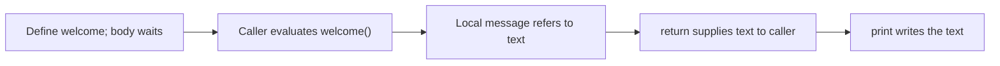
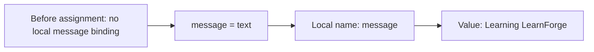
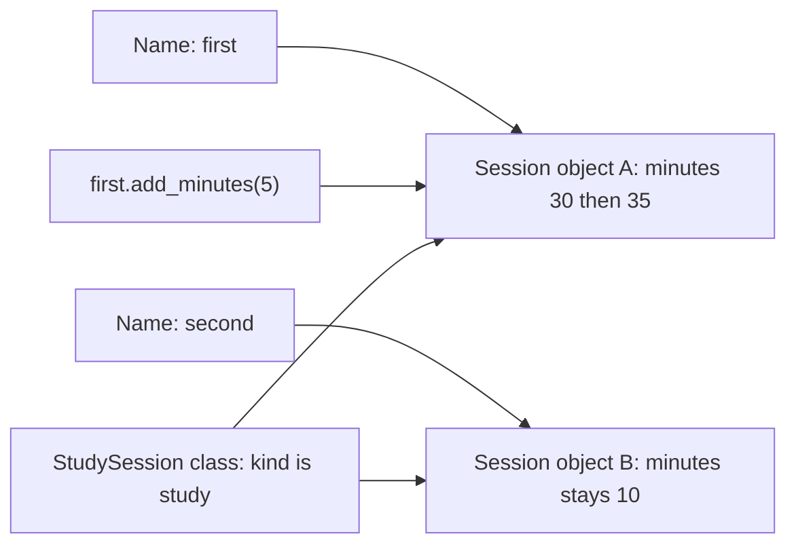
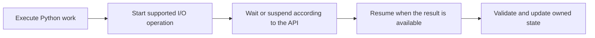

# Small pictures for code execution

Use one small picture when it helps explain the current code. These are teaching models of Python names, values and call order, not physical RAM addresses or measured CPU cycles. Start with Day 001's function and add objects/classes only when they have been taught. A real execution result accompanies the explanation; a picture never proves that code was run.

## First function: order of work

The runnable example is [first_function.py](examples/day-001/first_function.py).

The definition creates the function. The call starts its body. `return` gives the value to the caller; the caller's `print` produces output. Do not describe body lines as running immediately after `def` simply because they appear next on the page.

## Name and value before/after

Trace the actual executed example in this form:

| Step | Relevant name/state before | After | Why and product contribution |
|---|---|---|---|
| Define `welcome` | No function binding in this example yet | `welcome` refers to a function | Makes the welcome producer callable; does not run the body |
| Evaluate `welcome()` | Caller needs a value | A call starts with its own local context | Runs the producer for this display |
| Assign `message` | Local name has no binding yet | Refers to `"Learning LearnForge"` | Chooses the welcome text |
| `return message` | The function holds the text | The caller receives that text; the call ends | Supplies data for the screen without printing inside the producer |
| Caller prints | No console text from this call yet | Console contains the returned text | Makes this contribution visible; the text value is not changed |

For a changed example, run a copy with another message and update the table from that run. A line may read a value without changing it; explicitly say **no change**. Distinguish the command/actual output from the explanatory model of its execution.

## Objects and methods: Day 022 onward

Use [method_binding.py](examples/day-026/method_binding.py) after the classes prerequisites.

The instance method changes object A's `minutes`; it does not change object B or the class's `kind`. `self` identifies the receiving instance. Trace class attributes separately from instance attributes. A class method receives `cls` and can construct the class it was called on; a static method receives no automatic instance/class argument. Compare both with an ordinary module function before choosing a design. Their exact results come from the executed example, not an invented address diagram.

## CPU work and waiting: later concurrency lessons

This is a conceptual sequence, not a claim of parallel CPU execution. Later reviews distinguish synchronous work, event-loop suspension, threads/processes and the actual Python build. Use measured traces for timing claims and keep OS/runtime assumptions visible. Do not add CPU/memory internals to the first variable lesson.
