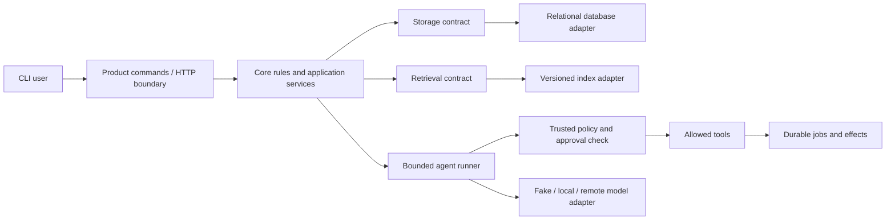

# LearnForge: an AI/ML workbench that grows from deep Python

## Goal and soul

LearnForge is one growing study and knowledge product. Its user journey is study planning → recorded sessions → a searchable knowledge library → cited answers → approved AI actions → useful measured AI/ML insights. Features become real through the implementation tasks.

Its learning approach is to teach the next required idea, implement a small useful function, execute it, explain every relevant change, and revisit the topic through mixed revision. Feature-based modules give each developer clear ownership; everyone retains common concepts and peer understanding. The issue itself contains the teaching needed for that task.

The first beginner increment uses `python run_demo.py onboarding`: six small learner-owned functions supply the onboarding screen. Their placeholders are runnable; learners change one value after a taught example. The earlier offline demo stays available.

LearnForge helps a learner or a team record study work, keep a workspace knowledge library, ask questions with sources, and turn knowledge into approved study plans. The same project grows throughout the course. Weekly increments are learning milestones within this product, not unrelated portfolio projects.

## Complete user flow

A user signs in, selects a workspace, records study sessions, uploads a note, sees ingestion status, asks a question, inspects cited evidence, asks for a study-plan draft, approves the exact proposed save action, and checks its durable run history. An operator can inspect safe status information, reconcile derived data, and restore a local backup.

The initial repository contains only a welcome/status starter. The curriculum describes the features learners will build. Real providers, a local model, a graph framework, and MCP are introduced through adapters; ordinary development retains synthetic data and fakes. API documentation is not a deliverable unless requested.

Optional [React web and React Native mobile tracks](CLIENT_TRACKS.md) will expose these same study, search, cited-answer, agent-approval and model-result flows through browser and device interfaces. They share the existing server authority and project architecture, with separate client feature ownership. They include a JavaScript/TypeScript bridge and JavaScript interview questions. Pratik/Pradeep are selected for React and Shubham for React Native. All live features use existing reviewed Python/FastAPI implementations. Frontend queues are separate; no client application is implemented by adding the curriculum.

## Growth and visible demonstrations

| Week | Visible increment |
|---|---|
| 1 | Study-time calculator with clear input and output |
| 2 | In-memory sessions, totals, and topic summaries |
| 3 | Save, restart, reload, and clear file/input failures |
| 4 | Session models and replaceable storage boundaries |
| 5 | Useful filtering/export and an installable package; small checks teach testing patterns |
| 6 | HTTP import preview, SQLite summaries, and atomic credit transfer |
| 7 | Create/read/list through a running FastAPI app and CLI client |
| 8 | Persistent records, migration, and stable bounded pagination |
| 9 | Login and owner-scoped operations with safe configuration |
| 10 | Bounded external work, durable job status, retries, idempotency, and progress |
| 11 | Runnable container/local staging, version/status view, and measured recovery |
| 12 | Deterministic document analysis and an explainable search baseline |
| 13 | Structured, budgeted note drafts through replaceable model adapters |
| 14 | Versioned text ingestion, chunks, embeddings, and scoped search |
| 15 | Cited answers, abstention, safe caching, and a small result-summary feature |
| 16 | Local/remote provider choice, adaptation data flow, and reviewed synthetic-image drafts |
| 17 | Bounded search-and-plan agent with safe tools and visible run steps |
| 18 | Checkpoint/resume, bounded memory, and exact approval before saving |
| 19 | Read-only MCP integration, scope, safe destinations, audit, and deletion flow |
| 20 | Durable run controls, limited orchestration, cancellation, and useful history |
| 21 | Complete workspace identity and session → note → answer → approved plan flow |
| 22 | Reliable events, version conflicts, read summaries, and resumable reconciliation |
| 23 | Capacity report, fair admission, budgets, fallback, incident view, and restore |
| 24 | Fresh setup demo, cross-role changes, maintainable boundaries, truthful portfolio evidence |
| 25–26 | Real product repairs identified by individual coding/design/project mock interviews |

## Internal component shape

This diagram is the target direction, not a claim that the starter already implements it. Start as a modular monolith: one deployable application with clear modules. Add a separate worker when durable background processing is taught. Discuss service extraction when independent load, ownership, deployment, or isolation makes it useful.

## Data the project gradually needs

Workspace, user/membership, session, document/version, chunk/index-version, generation configuration, plan/version, agent run/checkpoint, tool call/effect identity, approval, job/outbox event, usage budget, and minimal audit event. Introduce each only when its feature is taught. Keep authoritative records separate from derived indexes, summaries, caches, and temporary context.

## System-design threads through the product

Early weeks teach units, contracts, validation, state ownership, resource cleanup, and clear failure outcomes. API weeks add request lifetime, schema evolution, transactions, identity, access control, queues, backpressure, and observability. AI weeks add provenance, freshness, index lifecycle, context budgets, evidence, model limits, and spend. Agent weeks add trust boundaries, durable state, approved effects, replay, compensation, and cancellation. Integration weeks add capacity estimates, optimistic concurrency, replication trade-offs, reconciliation, degraded operation, and recovery.

Large-scale replication and partitioning are learned through a bounded routing simulator and design exercises; the product does not pretend that a small local deployment is an internet-scale service. Optional fine-tuning can use a tiny real experiment when hardware permits; the required data/configuration/comparison flow remains available without a GPU. Each developer must still explain the concept and demonstrate the required local behavior.

## Growth constraints

The [AI/ML and data-science extension plan](EXTENSIONS.md) reserves prediction, analytics, dataset/feature/model versioning, and batch/online inference boundaries. Its [mathematics bridge](MATH_FOUNDATIONS.md) connects statistics, probability, linear algebra, calculus, and optimization to the working product. It is a separate follow-on path; the core remains 26 weeks and 1,092 planned learner-days.

Build useful vertical slices. Keep a last working baseline. Do not create a framework for a hypothetical future feature. Never let a model enforce its own permission policy. Bind approvals and idempotency at actual effect boundaries. Keep user data scoped in database reads, retrieval, caches, memory, and logs. Make partial and unknown outcomes visible. Add API documentation only on request; keep testing light and attached to implementation.

## Primary learning destination

The project favors AI/ML learning and implementation. Its study records, documents, jobs, APIs, and model contracts supply meaningful data and runtime boundaries. All six build the common foundation, then each chooses and implements an advanced AI/ML capability in weeks 21–26. See [SPECIALIZATIONS.md](SPECIALIZATIONS.md). They retain one project-level architecture and contribute separate owned modules, rather than creating six unrelated platforms.
